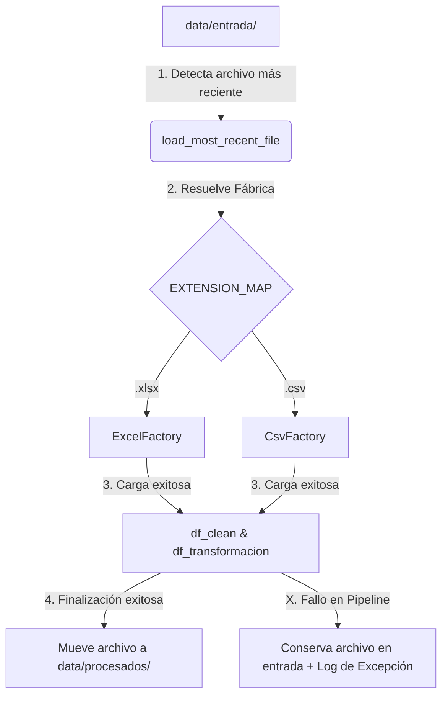

# 🚀 Enterprise ETL Pipeline: Cargue Automatizado de Proyectos de Leyes

Este es un pipeline robusto de Extracción, Transformación y Carga (ETL) desarrollado en Python, para la ingesta y auditoría automatizada de datos de proyectos de ley.
Este proyecto está diseñado bajo principios de arquitectura limpia, patrones de diseño de software y manejo avanzado de archivos.

---

## ✨ Características Principales & Decisiones de Diseño

*   **Arquitectura Orientada a Objetos (Fábricas):** Implementación del patrón *Factory Method* dinámico para instanciar lectores de datos específicos (`ExcelFactory`, `CsvFactory`) según la extensión del archivo, aislando la lógica de negocio de los formatos de origen.
*   **Ingesta Automatizada (Smart Loading):** Detección dinámica y autónoma del archivo más reciente en el directorio de entrada mediante marcas de tiempo del sistema de archivos (`mtime`).
*   **Transaccionalidad en Archivos:** Los archivos procesados se mueven de forma segura mediante operaciones de sistema (`shutil.move`) a un directorio histórico *únicamente* si el pipeline se ejecuta con éxito total (evitando pérdida o duplicación de datos).
*   **Observabilidad Completa (Logging Dinámico):** Sistema de logs en espejo (Consola y Archivo) acoplado al ciclo de vida del script principal (`sys.argv`). Genera trazas cronológicas detalladas por ejecución con formato `[Script]_[YYYYMMDD_HH24MISS].log` para fácil depuración.
*   **Estrategia Solid y Modular:** Separación estricta de responsabilidades en capas aisladas: Extracción (`file_manager`), Limpieza (`df_clean`), Transformación (`df_transformacion_01`) y Orquestación (`pipeline`).

*   **Los modulos de lectura, manejo de archivos y manejo de logs son reutilizables, y fueron diseñados para usarlos en otros proyectos de este mismo portafolio
---

## 🛠️ Stack Tecnológico

*   **Lenguaje:** Python 3.12+
*   **Análisis de Datos:** Pandas
*   **I/O & Sistema de Archivos:** Pathlib, Shutil
*   **Monitoreo:** Logging (Standard Library)

---

## 📂 Estructura del Proyecto

```text
├── data/
│   ├── entrada/            # Directorio donde se depositan los nuevos archivos
│   └── procesados/         # Histórico de archivos procesados exitosamente. Esta carpeta debe ser depurada segun las reglas de negocio para manejo de datos históricos.
├── utils/
│   ├── __init__.py             # Metodo constructor del proyecto.
│   ├── df_clean.py             # Reglas de negocio para limpieza de datos del dataframe.
│   ├── df_transformacion.py    # Transformación y feature engineering de dataframe.
│   ├── pipeline.py             # Orquestador central del flujo ETL Puede ser reemplazado por un orquestador, como Apache airflow.
├── leyes.py                    # Script de entrada de la aplicación (CLI).
├── leyes_YYYYMMDD_HH24MISS.log # Logs generados dinámicamente. Estos archivos deben ser depurados segun las reglas de negocio para manejo de logs.
├── .gitignore                  # Lista de objetos que no se quiere subir a github
└── README.md

```

---

## ⚙️ Configuración y Ejecución

### 1. Requisitos Previos
Clona el repositorio e instala las dependencias necesarias:
```bash
git clone https://github.com
cd tu-repositorio
pip install pandas openpyxl
```

### 2. Ejecutar el Pipeline
Para inicializar el orquestador y procesar el lote de datos más reciente, ejecuta el script principal:
```bash
python leyes.py
python3 leyes.py
```

---

## 📊 Ciclo de Vida del Flujo de Datos



---

## 📝 Ejemplo de Observabilidad (Logs en Tiempo Real)

Cada ejecución genera automáticamente un diagnóstico limpio y detallado. Ejemplo de salida en consola y archivo `.log`:

```text
2026-09-19 20:20:25,078 [INFO] (file_manager.py:35) - Archivo más reciente detectado automáticamente: 'proyectos_ley_20260918_171249.xlsx'
2026-09-19 20:20:25,120 [INFO] (pipeline.py:27) - --- Fase 1/3: Extracción de datos ---
2026-09-19 20:20:25,845 [INFO] (pipeline.py:29) - Fase 1 Completada. Dimensiones iniciales: (1524, 18)
2026-09-19 20:20:25,850 [INFO] (pipeline.py:32) - --- Fase 2/3: Limpieza de datos ---
2026-09-19 20:20:26,102 [INFO] (file_manager.py:54) - Archivo movido exitosamente a: 'data/procesados/proyectos_ley_20260918_171249.xlsx'
2026-09-19 20:20:26,105 [INFO] (pipeline.py:42) - === [FIN SUCCESSFUL] El Pipeline ha terminado con éxito ===
```

---
💡 **Nota para Reclutadores:** Este proyecto fue construido simulando un ambiente de producción, priorizando la resiliencia al fallo (error handling robusto), el código autodocumentado mediante *type hinting* y la escalabilidad de la arquitectura.

